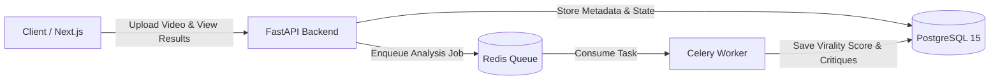

<!-- Plain-English description: This is the main project README describing VibeCheck, its architecture, setup instructions, and final project checklist. -->

# VibeCheck: Multimodal Virality Engine

VibeCheck is a student capstone project designed to evaluate and enhance short-form video content virality. A creator uploads a short video, an asynchronous background worker analyzes the video across multimodal dimensions (such as hook pacing, emotional tone, and audience retention fit), and the creator receives an overall virality score alongside detailed, actionable critiques.

## Architecture

The system consists of a Next.js client, a FastAPI REST API backend, a PostgreSQL relational database, a Redis task queue, and a Celery background worker.



## How to Run

Follow these exact steps to run the complete VibeCheck platform:

### 1. Copy Environment Configuration
```bash
cp .env.example .env
```
*(On Windows PowerShell, use: `Copy-Item .env.example .env`)*

### 2. Generate RSA Keypair for RS256 JWT Signing
```bash
python scripts/generate_keys.py
```
This generates `jwt_rs256.key` (private key) and `jwt_rs256.key.pub` (public key).

### 3. Start All 5 Services via Docker Compose
```bash
docker compose up --build
```
This builds and starts:
1. `postgres` (PostgreSQL 15, auto-executing `/db` SQL files: schema, views, triggers, procedures, seed)
2. `redis` (Redis 7 task broker)
3. `backend` (FastAPI REST API at `http://localhost:8000`)
4. `worker` (Celery background worker consuming `process_video` tasks)
5. `frontend` (Next.js web application at `http://localhost:3000`)

### 4. URLs to Open
- **Web App (Frontend):** [http://localhost:3000](http://localhost:3000)
- **API Documentation (Swagger UI):** [http://localhost:8000/docs](http://localhost:8000/docs)

### 5. Dev Login Credentials (DEV ONLY)
- **Creator Account:**
  - Email: `creator@vibecheck.test`
  - Password: `CreatorDevPassword123!`
- **Admin Account:**
  - Email: `admin@vibecheck.test`
  - Password: `AdminDevPassword123!`

---

## Final Project Checklist

- [x] **6 tables:** `Users`, `TargetPersonas`, `Videos`, `ViralityPredictions`, `AgentCritiques`, `AuditLogs` (`db/schema.sql`, `backend/models.py`)
- [x] **3 indexes:** `idx_videos_user_upload`, `idx_pred_class_score`, `idx_users_email` (`db/schema.sql`)
- [x] **1 view:** `v_creator_performance_summary` (`db/views.sql`)
- [x] **1 trigger:** `trg_audit_video_upload` (`db/triggers.sql`)
- [x] **1 stored procedure:** `sp_record_virality_and_critiques` (`db/procedures.sql`)
- [x] **4 endpoints work:** `POST /api/v1/auth/login`, `POST /api/v1/videos/upload`, `GET /api/v1/analysis/{id}`, `GET /api/v1/metrics/view` (`backend/main.py`)
- [x] **tests pass:** 11/11 automated pytest tests passing (`backend/tests/test_api.py`, `worker/tests/test_worker.py`)
- [ ] **docker compose runs end-to-end:** Configuration files, Dockerfiles, and compose manifests are fully specified, but Docker Desktop is not installed on this host environment
- [x] **4 docs files written:** `docs/database.md`, `docs/system-design.md`, `docs/dp900.md`, `docs/security-stride.md` (and `infra/azure-architecture.md`)
- [x] **no secrets in repo:** `.env.example` has placeholders only, `.env` and `jwt_rs256.key` excluded in `.gitignore`, no live cloud secrets committed
- [x] **every file has a header comment:** All code, SQL, config, and markdown files start with a plain-English explanation
