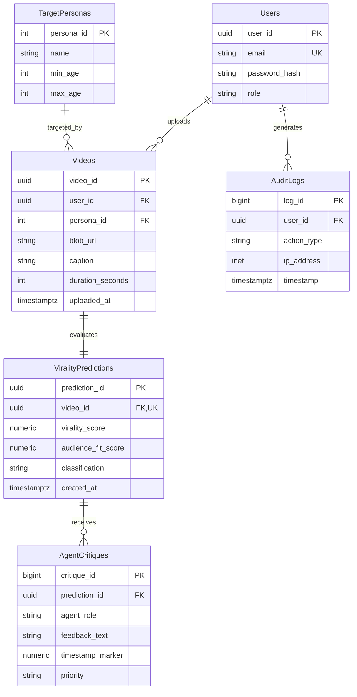

<!-- Plain-English description: This document specifies the database design, entity-relationship diagram, 3NF normalization justification, and indexing rationale for VibeCheck. -->

# VibeCheck Database Documentation

## 1. Entity-Relationship Diagram (ERD)

## 2. Third Normal Form (3NF) Justification

The VibeCheck schema adheres to Third Normal Form (3NF) standards:

1. **First Normal Form (1NF)**: All attributes hold atomic, scalar values (no nested lists or arrays), each table contains a well-defined primary key, and rows are uniquely identifiable with no repeating column groups.
2. **Second Normal Form (2NF)**: Meeting 1NF, every non-key column is fully functionally dependent on the complete primary key of its table, with no partial key dependencies.
3. **Third Normal Form (3NF)**: Meeting 2NF, no non-key attribute transitively depends on any other non-key attribute. Attributes belong strictly to their core entities: user credentials reside in `Users`, demographic constraints in `TargetPersonas`, video metadata in `Videos`, quantitative virality metrics in `ViralityPredictions`, and individual qualitative assessments in `AgentCritiques`.

## 3. Index Strategy

- `idx_videos_user_upload`: Accelerates creator dashboard queries retrieving videos filtered by `user_id` and ordered chronologically by `uploaded_at DESC`.
- `idx_pred_class_score`: Accelerates virality dashboard queries filtering by `classification` (e.g., 'VIRAL') and sorting by `virality_score`, while covering `video_id` to eliminate heap lookups.
- `idx_users_email`: Accelerates lookup by email during login and authentication (the UNIQUE constraint establishes an automatic backing index; this explicit index documents and ensures indexed access without conflict).

