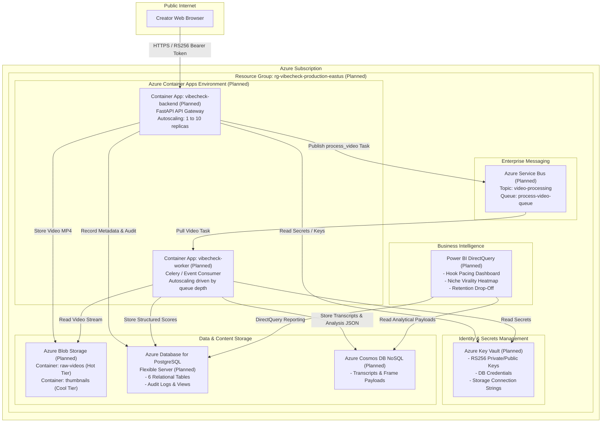

<!-- Plain-English description: Cloud architecture documentation detailing the planned Microsoft Azure production deployment layout for VibeCheck. -->

# VibeCheck Planned Azure Architecture

All cloud infrastructure elements described in this document are design specifications and are marked as **Planned**.

## 1. Planned Cloud Architecture Diagram

## 2. Planned Azure Component Mapping

| Azure Component | Resource Name | Role / Function | Status |
|---|---|---|---|
| **Resource Group** | `rg-vibecheck-production-eastus` | Logical container for all project assets in East US | Planned |
| **Azure Container Apps (API)** | `ca-vibecheck-api` | Hosts the containerized FastAPI backend with TLS termination | Planned |
| **Azure Container Apps (Worker)** | `ca-vibecheck-worker` | Hosts background worker scale-out instances | Planned |
| **PostgreSQL Flexible Server** | `psql-vibecheck-prod` | Manages relational schema, views, audit tables, and stored procedures | Planned |
| **Azure Blob Storage** | `stgvideoanalysesprod` | High-throughput object store for video uploads and media assets | Planned |
| **Azure Cosmos DB** | `cosmos-vibecheck-transcripts` | Document store for variable-length Whisper transcripts and agent evaluations | Planned |
| **Azure Service Bus** | `sb-vibecheck-messaging` | Production asynchronous message broker replacing local Redis | Planned |
| **Azure Key Vault** | `kv-vibecheck-secrets` | Centralized hardware security module for RSA keys and database credentials | Planned |
| **Power BI Service** | `pbi-vibecheck-workspace` | Executive and creator reporting powered by DirectQuery | Planned |
